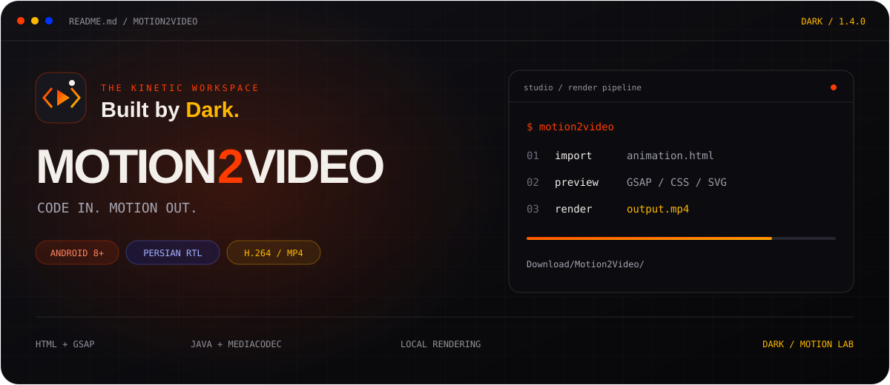
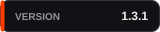
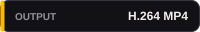

<div align="center">

[English](README.md) · **فارسی**



# Motion2Video Pro

**کدت را به حرکت تبدیل کن؛ حرکتت را به ویدیو.**






[دریافت APK اندروید](https://github.com/imthedark-dark/motion2video-pro/releases/download/v1.3.1-dark/Motion2Video-1.3.1-Dark.apk) · [همهٔ فایل‌های انتشار](https://github.com/imthedark-dark/motion2video-pro/releases/tag/v1.3.1-dark)

[معرفی](#overview) · [شروع سریع](#quick-start) · [دانلودها](#downloads) · [ساخت از سورس](#build) · [وضعیت آزمون‌ها](#validation)

</div>

---

<div dir="rtl" lang="fa">

<a id="overview"></a>
## استودیوی حرکت، در جیب تو

**Motion2Video Pro** یک برنامهٔ اندرویدی با رابط فارسی و راست‌به‌چپ است: HTML موشن را وارد کن، پیش‌نمایش را ببین و با موتور بومی اندروید خروجی ویدیو بساز. رابط تیره، لوگوی اختصاصی، حرکت‌های GSAP و امضای **Dark** همراه پروژه‌اند.

<div dir="ltr">

```text
animation.html  →  preview  →  frame-by-frame render  →  video.mp4
                                                        │
                                         Download/Motion2Video/
```

</div>

| بساز | خروجی بگیر | نگه دار |
| :--- | :--- | :--- |
| HTML / CSS / SVG / GSAP | مسیر اصلی H.264 در MP4 | ذخیرهٔ خودکار در دانلودها |
| قلم‌های فارسی و عربی همراه برنامه | 30 یا 60fps قابل انتخاب | نمایش نام و مسیر هر فایل |
| پیش‌نمایش و بازپخش موشن | حالت افقی و عمودی | بازکردن فایل و دانلودهای گوشی |

<a id="quick-start"></a>
## سه قدم تا اولین ویدیو

1. **وارد کن:** فایل HTML مستقل موشن را انتخاب کن یا نمونهٔ آماده را اجرا کن.
2. **ببین و تنظیم کن:** پیش‌نمایش، مدت، اندازه، نرخ فریم و کدک را بررسی کن.
3. **رندر بگیر:** برنامه را باز نگه دار؛ پس از پایان، نتیجهٔ ذخیره و مسیر فایل را ببین.

> حداقل Android 8 لازم است. APK آزمایشیِ امضاشده را از [صفحهٔ انتشار](https://github.com/imthedark-dark/motion2video-pro/releases/tag/v1.3.1-dark) دریافت کن یا از سورس بساز.

<a id="downloads"></a>
## خروجی‌هایت، یک‌جا

<div dir="ltr">

```text
Download/
└── Motion2Video/
    └── Motion2Video_20261117_120000_001_abc123.mp4
```

</div>

بخش **دانلودهای من** نام، مسیر، حجم و زمان فایل‌های ثبت‌شدهٔ همین برنامه را نشان می‌دهد. دکمهٔ بازکردن فایل، آن را به پخش‌کنندهٔ گوشی می‌دهد؛ دکمهٔ پوشه، فایل‌منیجر سازگار یا صفحهٔ دانلودهای سیستم را باز می‌کند. فهرست پس از بستن برنامه باقی می‌ماند.

Android 10+ از MediaStore.Downloads استفاده می‌کند؛ روی Android 8 و 9 اجازهٔ ذخیره در حافظه لازم است. برای VP8/VP9 پسوند واقعی فایل `.webm` خواهد بود.

## جعبه‌ابزار استودیو

| بخش | ابزارها |
| :--- | :--- |
| رابط | یک فایل HTML، Tailwind، GSAP و SVG |
| رندر اندروید | Java، MediaCodec، MediaMuxer، FastStart |
| موشن همراه | GSAP Core و پنج افزونه، Lottie، Three.js |
| تایپوگرافی | Vazirmatn، Amiri، Noto Naskh Arabic، Scheherazade New، Anton، Inter |
| مسیر اختیاری کامپیوتر | FFmpeg برای تبدیل و ترکیب صدا |

خروجی اندروید فعلاً **بی‌صدا** است. HEVC/AV1 و VP8/VP9 به قابلیت گوشی وابسته‌اند؛ ProRes/MOV/alpha در APK پیاده نشده‌اند. انتخاب 1080p یا 60fps به معنی پشتیبانی همهٔ دستگاه‌ها از آن ترکیب نیست.

<a id="build"></a>
## از سورس اجرا کن

JDK 17+، Python 3، Android SDK Platform 35 و Build Tools 35.0.0 لازم‌اند.

<div dir="ltr">

```sh
export ANDROID_SDK_ROOT=/path/to/Android/Sdk
python3 build.py
```

</div>

فایل نصب آزمایشی در `dist/` ساخته می‌شود. کلید محلی `build/debug.jks` وارد Git نمی‌شود. نسخه‌های ساخته‌شده روی سیستم‌های مختلف، امضای آزمایشی مستقل دارند.

<details>
<summary><strong>آزمون رابط و ساعت انیمیشن</strong></summary>

<div dir="ltr">

```sh
npm ci
npx playwright-core install chromium
npm run test:ui
npm run test:clock
```

</div>

برای Chromium نصب‌شدهٔ سیستم، `CHROMIUM_PATH` را به فایل اجرایی مرورگر تنظیم کن. [راهنمای فنی کامل](docs/BUILD.md) شامل ساخت اندروید، ساختار کد و جزئیات محدودیت‌هاست.

</details>

<a id="validation"></a>
## وضعیت واقعی آزمون‌ها

| بررسی | وضعیت |
| :--- | :--- |
| ساخت مستقل سورس و بررسی امضای APK | انجام شده |
| رابط موبایل/دسکتاپ و پیام‌های بخش دانلود | انجام شده؛ پل بومی شبیه‌سازی شده |
| ساعت انیمیشن: API جدید و مسیر جایگزین CSS | انجام شده |
| رندر واقعی MP4 یک‌ثانیه‌ای، 360p/30fps | روی شبیه‌ساز Android 11 در نسخهٔ ۱.۲ بررسی شده |
| ذخیرهٔ جدید MediaStore و مسیر Android 8/9 | هنوز آزمون اجرایی اندروید نشده |
| گوشی واقعی، همهٔ کدک‌ها، 1080p60 و WebGL | آزمون پذیرش نشده |

نمونهٔ رندر قبلی در [`tests/fixtures`](tests/fixtures) موجود است. ضبط MP4 در فایل HTML مستقل مرورگر به پشتیبانی همان مرورگر وابسته است.

## نقشهٔ پروژه

<div dir="ltr">

```text
app/       Android app, media engine, fonts & libraries
ui/        Single-file Persian studio interface
desktop/   Optional FFmpeg export tool
tests/     UI, animation clock & Android test sources
tools/     Source audit & dependency update checker
docs/      Build guide & original README graphics
```

</div>

## حریم خصوصی و اعتبارها

کلید خصوصی امضا، توکن، تنظیمات محلی، لاگ محیط و دادهٔ کاربر از انتشار کنار گذاشته شده‌اند. HTML واردشده برای رندر به سرور برنامه ارسال نمی‌شود؛ منابع خارجی همان HTML می‌توانند از شبکه استفاده کنند. [بررسی سورس](SECURITY.md) و [مجوزهای کتابخانه‌ها و فونت‌ها](THIRD_PARTY_NOTICES.md) در مخزن نگه داشته می‌شوند.

طراحی این README با الهام از **Wow Profile** معرفی‌شده در [پست GitSkins](https://www.instagram.com/p/Dep83b7oDEb/) انجام شده است. بنر و نشان‌های این پروژه اختصاصی‌اند.

</div>

---

<div align="center">

**Dark** · Code in. Motion out.

</div>
