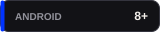
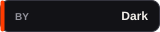

<div align="center">

[English](README.md) · **فارسی**


# Motion2Video Pro

**کدت را به حرکت تبدیل کن؛ حرکتت را به ویدیو.**






[دریافت APK اندروید](https://github.com/imthedark-dark/motion2video-pro/releases/download/v1.4.1/Motion2Video-1.4.1-Dark.apk) · [همهٔ فایل‌های انتشار](https://github.com/imthedark-dark/motion2video-pro/releases/tag/v1.4.1)

[معرفی](#overview) · [شروع سریع](#quick-start) · [دانلودها](#downloads) · [ساخت از سورس](#build) · [وضعیت آزمون‌ها](#validation)

</div>

---

<div dir="rtl" lang="fa">

<a id="overview"></a>
## استودیوی حرکت، در جیب تو

**Motion2Video Pro** یک برنامهٔ اندرویدی با رابط فارسی و راست‌به‌چپ است: HTML موشن را وارد کن، پیش‌نمایش را ببین و با موتور بومی اندروید خروجی ویدیو بساز. رابط تیره، لوگوی اختصاصی، حرکت‌های GSAP و امضای **Dark** همراه پروژه‌اند.

<div dir="ltr">

```text
animation.html  →  preview  →  frame-by-frame render  →  video.mp4
                                                        │
                                         Download/Motion2Video/
```

</div>

| بساز | خروجی بگیر | نگه دار |
| :--- | :--- | :--- |
| HTML / CSS / SVG / GSAP | مسیر اصلی H.264 در MP4 | ذخیرهٔ خودکار در دانلودها |
| قلم‌های فارسی و عربی همراه برنامه | 30 یا 60fps قابل انتخاب | نمایش نام و مسیر هر فایل |
| پیش‌نمایش و بازپخش موشن | حالت افقی و عمودی | بازکردن فایل و دانلودهای گوشی |
| سرویس مستقل رندر پس‌زمینه | دو بافر فریم قابل استفادهٔ مجدد | اعلان پیشرفت و کنترل لغو |

<a id="quick-start"></a>
## سه قدم تا اولین ویدیو

1. **وارد کن:** فایل HTML مستقل موشن را انتخاب کن یا نمونهٔ آماده را اجرا کن.
2. **ببین و تنظیم کن:** پیش‌نمایش، مدت، اندازه، نرخ فریم و کدک را بررسی کن.
3. **رندر بگیر:** کار را شروع کن و در صورت نیاز به برنامهٔ دیگری برو. پیشرفت در اعلان و نتیجه و مسیر فایل پس از بازگشت به برنامه در دسترس‌اند.

> حداقل Android 8 لازم است. APK و چک‌سام از GitHub Releases دریافت می‌شوند؛ فایل باینری در این شاخه وارد Git نمی‌شود. APK آزمایشیِ امضاشده را از [صفحهٔ انتشار](https://github.com/imthedark-dark/motion2video-pro/releases/tag/v1.4.1) دریافت کن یا از سورس بساز.

<a id="downloads"></a>
## خروجی‌هایت، یک‌جا

<div dir="ltr">

```text
Download/
└── Motion2Video/
    └── Motion2Video_20261117_120000_001_abc123.mp4
```

</div>

بخش **دانلودهای من** نام، مسیر، حجم و زمان فایل‌های ثبت‌شدهٔ همین برنامه را نشان می‌دهد. دکمهٔ بازکردن فایل، آن را به پخش‌کنندهٔ گوشی می‌دهد؛ دکمهٔ پوشه، فایل‌منیجر سازگار یا صفحهٔ دانلودهای سیستم را باز می‌کند. فهرست پس از بستن برنامه باقی می‌ماند.

Android 10+ از MediaStore.Downloads استفاده می‌کند؛ روی Android 8 و 9 اجازهٔ ذخیره در حافظه لازم است. برای VP8/VP9 پسوند واقعی فایل `.webm` خواهد بود.

## سخت‌سازی امنیتی — بازبینی فاز اول

در شاخهٔ `security/phase-1`، محتوای واردشده پیش‌فرض آفلاین است. اجازهٔ منابع آنلاین به تأیید هشدار فارسی نیاز دارد و به کد اجازهٔ تماس با سرورهای HTTPS می‌دهد. فونت‌ها و کتابخانه‌های همراه اندروید محلی‌اند. مرزبندی WebViewها، اعتبارسنجی پیام، CSP و مدیریت توقف پردازشگر تقویت شده‌اند. [گزارش ممیزی](docs/AUDIT_REPORT.md)، [تصمیم‌ها](docs/DECISIONS.md) و [آزمون‌ها و محدودیت‌ها](docs/PHASE1_SECURITY.md) را ببین. این تغییر سورس هنوز داخل APK منتشرشدهٔ ۱.۴.۱ نیست؛ گوشی واقعی آزموده نشده است؛ بررسی‌های بعدی شبیه‌ساز در فاز دوم ثبت شده‌اند.

## سخت‌سازی اندروید — بازبینی فاز دوم

شاخهٔ `security/phase-2`، FileProvider فقط‌خواندنی با مسیر محدود، تنظیم صریح شبکه، توضیح رد مجوز و توقف امن سرویس هنگام پایان مهلت اندروید را اضافه می‌کند. فرمان `python3 build.py` از Gradle همراه پروژه استفاده می‌کند؛ گزینهٔ `--release` نسخهٔ کوچک‌سازی‌شده و بدون امضای انتشار می‌سازد. JDK 17 کامل لازم است و اولین دریافت وابستگی‌ها اینترنت می‌خواهد.

نسخهٔ release کوچک‌سازی‌شده روی شبیه‌ساز Android 11، ویدیوی H.264 در 360p30 ساخت، ذخیره و پخش کرد. آزمون‌های FileProvider، پایان مهلت و توقف واقعی پردازشگر هم موفق شدند. گوشی واقعی و فراخوانی واقعی سهمیهٔ Android 15 هنوز آزموده نشده‌اند. [جزئیات فاز دوم](docs/PHASE2_ANDROID.md) و [شواهد ممیزی](docs/AUDIT_REPORT.md) موجود است؛ APKهای منتشرشده تغییر نکرده‌اند.

## رندر پس‌زمینه و سرعت

رندر در سرویس پیش‌زمینه با نمایشگر مجازی خصوصی اجرا می‌شود و به صفحهٔ برنامه وابسته نیست. رفتن به Home، جابه‌جایی بین برنامه‌ها و بستن صفحهٔ برنامه، کار را لغو نمی‌کند. با بازگشت، پیشرفت یا نتیجهٔ ذخیره‌شده بازیابی می‌شود. برای دیدن پیشرفت و دکمهٔ لغو در اعلان، مجوز اعلان را بده.

دو بافر قابل استفادهٔ مجدد، برداشت فریم را با کدگذاری هم‌زمان می‌کنند. پیام آماده‌شدن فریم جای polling و انتظار اضافهٔ صفحه را گرفته است. تبدیل RGB به YUV با نوشتن سطری سریع‌تر شده، ولی محاسبات رنگ قبلی دقیقاً حفظ شده‌اند. برای افزایش سرعت، اندازه، بیت‌ریت، نرخ فریم یا تعداد فریم‌ها کاهش نمی‌یابد.

در یک آزمون دسکتاپ JVM، تبدیل سی فریم 720p از ۱۵۲٫۷ به ۹۳٫۳ میلی‌ثانیه رسید؛ حدود ۱٫۶۴ برابر برای همین مرحلهٔ تبدیل رنگ. این عدد سرعت کل خروجی یا بنچمارک گوشی نیست؛ سرعت واقعی به دستگاه و HTML بستگی دارد.

**توقف اجباری، پایان فرایند و بعضی محدودیت‌های باتری گوشی همچنان می‌توانند کار را قطع کنند.** پس از Force stop، رندر خودکار از همان نقطه ادامه نمی‌یابد. اندروید برای سرویس هم سقف زمانی دارد. [جزئیات عملکرد و پس‌زمینه](docs/PERFORMANCE.md).

## جعبه‌ابزار استودیو

| بخش | ابزارها |
| :--- | :--- |
| رابط | یک فایل HTML، Tailwind، GSAP و SVG |
| رندر اندروید | Java، MediaCodec، MediaMuxer، FastStart |
| موشن همراه | GSAP Core و پنج افزونه، Lottie، Three.js |
| تایپوگرافی | Vazirmatn، Amiri، Noto Naskh Arabic، Scheherazade New، Anton، Inter |
| مسیر اختیاری کامپیوتر | FFmpeg برای تبدیل و ترکیب صدا |

خروجی اندروید فعلاً **بی‌صدا** است. HEVC/AV1 و VP8/VP9 به قابلیت گوشی وابسته‌اند؛ ProRes/MOV/alpha در APK پیاده نشده‌اند. انتخاب 1080p یا 60fps به معنی پشتیبانی همهٔ دستگاه‌ها از آن ترکیب نیست.

<a id="build"></a>
## از سورس اجرا کن

JDK 17+، Python 3، Android SDK Platform 35 و Build Tools 35.0.0 لازم‌اند.

<div dir="ltr">

```sh
export ANDROID_SDK_ROOT=/path/to/Android/Sdk
python3 build.py
```

</div>

فایل نصب آزمایشی در `dist/` ساخته می‌شود. کلید محلی `build/debug.jks` وارد Git نمی‌شود. نسخه‌های ساخته‌شده روی سیستم‌های مختلف، امضای آزمایشی مستقل دارند.

<details>
<summary><strong>آزمون رابط و ساعت انیمیشن</strong></summary>

<div dir="ltr">

```sh
npm ci
npx playwright-core install chromium
npm run test:ui
npm run test:clock
python3 tools/test_yuv.py
```

</div>

برای Chromium نصب‌شدهٔ سیستم، `CHROMIUM_PATH` را به فایل اجرایی مرورگر تنظیم کن. [راهنمای فنی کامل](docs/BUILD.md) شامل ساخت اندروید، ساختار کد و جزئیات محدودیت‌هاست.

</details>

<a id="validation"></a>
## وضعیت واقعی آزمون‌ها

| بررسی | وضعیت |
| :--- | :--- |
| ساخت مستقل سورس و بررسی امضای APK | انجام شده |
| رابط موبایل/دسکتاپ و پیام‌های بخش دانلود | انجام شده؛ پل بومی شبیه‌سازی شده |
| ساعت انیمیشن: API جدید و مسیر جایگزین CSS | انجام شده |
| رندر واقعی MP4 یک‌ثانیه‌ای، 360p/30fps | روی شبیه‌ساز Android 11 در نسخهٔ ۱.۲ بررسی شده |
| رندر سرویس پس‌زمینه، Home و ذخیرهٔ MediaStore | روی شبیه‌ساز Android 11 در 360p30 بررسی شده |
| بستن صفحه، بازیابی ویدیو/مسیر/تنظیمات و لغو فوری و از اعلان | روی شبیه‌ساز Android 11 بررسی شده |
| ۷۲ حالت stride/offset و صفحهٔ UV مشترک | خروجی بایت‌به‌بایت یکسان با تبدیل قبلی |
| ذخیرهٔ Android 8/9 و مجوز اعلان Android 13+ | روی دستگاه آزمون پذیرش نشده |
| گوشی واقعی، همهٔ کدک‌ها، 1080p60 و WebGL | آزمون پذیرش نشده |

نمونه‌های رندر در [`tests/fixtures`](tests/fixtures) موجود است. ضبط MP4 در فایل HTML مستقل مرورگر به پشتیبانی همان مرورگر وابسته است.

## نقشهٔ پروژه

<div dir="ltr">

```text
app/       Android app, media engine, fonts & libraries
ui/        Single-file Persian studio interface
desktop/   Optional FFmpeg export tool
tests/     UI, animation clock & Android test sources
tools/     Source audit & dependency update checker
docs/      Build guide & original README graphics
```

</div>

## مجوز، شواهد و برنامهٔ توسعه

کد و مستندات اصلی پروژه با [مجوز MIT](LICENSE) منتشر می‌شوند. GSAP مجوز اختصاصی خود را حفظ می‌کند؛ کل وابستگی‌های بسته را نباید MIT/OSI معرفی کرد. [مرز مجوزها](docs/LICENSING.md) و [اعلان‌های کتابخانه‌ها](THIRD_PARTY_NOTICES.md) را ببین.

[مشارکت](CONTRIBUTING.md) · [آزمون‌های قابل بازتولید و وضعیت دستگاه‌ها](docs/VALIDATION.md) · [آمار عمومی واقعی](docs/METRICS.md) · [هدف و برنامهٔ توسعه](docs/IMPACT_AND_ROADMAP.md) · [وضعیت چک‌لیست](docs/READINESS.md)

نسخهٔ ۱.۴.۱ متن مجوزها را داخل APK بسته‌بندی می‌کند و مستندات را تکمیل می‌کند؛ رفتار رندر همان نسخهٔ ۱.۴ است.

## حریم خصوصی و اعتبارها

کلید خصوصی امضا، توکن، تنظیمات محلی، لاگ محیط و دادهٔ کاربر از انتشار کنار گذاشته شده‌اند. HTML واردشده برای رندر به سرور برنامه ارسال نمی‌شود؛ منابع خارجی همان HTML می‌توانند از شبکه استفاده کنند. [بررسی سورس](SECURITY.md) و [مجوزهای کتابخانه‌ها و فونت‌ها](THIRD_PARTY_NOTICES.md) در مخزن نگه داشته می‌شوند.

طراحی این README با الهام از **Wow Profile** معرفی‌شده در [پست GitSkins](https://www.instagram.com/p/Dep83b7oDEb/) انجام شده است. بنر و نشان‌های این پروژه اختصاصی‌اند.

</div>

---

<div align="center">

**Dark** · Code in. Motion out.

</div>

### بررسی امنیتی فاز ۳

ورود HTML تا ۲۰ مگابایت با بررسی پسوند، نوع فایل و UTF-8 معتبر انجام می‌شود. تنظیمات در مرزهای ورودی اعتبارسنجی می‌شوند. بررسی حافظه پیش از رندر، پایش دوره‌ای حافظه، مهلت دو ساعته و لغو انتظار اسکریپت، کارهای سنگین یا متوقف را بدون تغییر کیفیت و زمان‌بندی فریم‌ها قطع می‌کند. [جزئیات و روش آزمون](docs/PHASE3_INPUT.md). حافظهٔ GPU و فرایند وب و فراخوانی‌های مسدود سیستم کاملاً زیر کنترل برنامه نیستند. APK منتشرشده با این شاخه جایگزین نشده است.

ساخت و آزمون‌های میزبان فاز ۳ موفق بودند. تأیید اجرا روی اندروید هنوز انجام نشده: فرایند سیستم و ActivityManager شبیه‌ساز پیش از شروع آزمون از کار افتادند؛ گوشی واقعی هم آزمایش نشده است.

### بررسی انتشار و زنجیرهٔ تأمین فاز ۴

امضای انتشار فقط با `python3 build.py --release --sign` و تنظیمات محیط یا فایل محلی نادیده‌گرفته‌شده فعال می‌شود؛ ساخت آزمایشی و خروجی بدون امضا همچنان ممکن است. نام نسخهٔ APK از خروجی واقعی Gradle خوانده می‌شود. باینری‌ها از این شاخه حذف شده‌اند؛ تگ‌ها و فایل‌های انتشار قبلی تغییری نکرده‌اند. اکشن‌ها با SHA کامل و دسترسی پیش‌فرض فقط‌خواندنی ثابت شده‌اند؛ تنها کار انتشارِ صریح و کنترل‌شده مجوز نوشتن دارد؛ Dependabot، ممیزی npm، اسکن مستقل OWASP و بررسی نسخه/هش/مجوز دارایی‌ها اضافه شده‌اند. [روش انتشار](docs/RELEASE.md)، [وضعیت گزارش خصوصی](SECURITY.md) و [محدودیت مجوزها](docs/LICENSING.md) را ببین. نسخهٔ تولیدی جدید منتشر نشده و آزمون واقعی اندروید هنوز تأیید نشده است.

کارهای بیرونی باقی‌مانده: گزارش خصوصی به‌دلیل خطای403 گیت‌هاب هنوز غیرفعال است و مالک باید آن را فعال کند. اسکن کامل OWASP به‌دلیل دسترسی NVD/CISA کامل نشده؛ نتیجهٔ پاک بودن وابستگی‌ها ادعا نمی‌شود.
