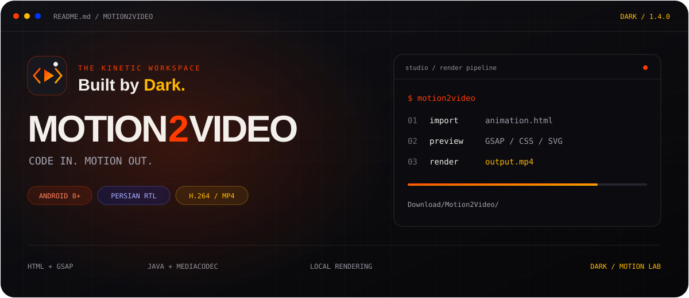
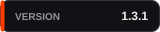
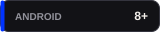
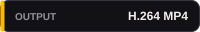
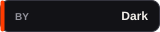

<div align="center">

**English** · [فارسی](README.fa.md)



# Motion2Video Pro

**Turn code into motion. Turn motion into video.**






[Overview](#overview) · [Quick start](#quick-start) · [Downloads](#downloads) · [Build](#build) · [Validation](#validation)

</div>

---

<div dir="ltr" lang="en">

<a id="overview"></a>
## A motion studio in your pocket

**Motion2Video Pro** is an Android app with a Persian, right-to-left interface. Import an HTML animation, preview it, and export video with Android's native media engine. The project includes a dark studio UI, an original vector logo, GSAP motion, and the **Dark** signature.

```text
animation.html  →  preview  →  frame-by-frame render  →  video.mp4
                                                        │
                                         Download/Motion2Video/
```

| Create | Export | Keep |
| :--- | :--- | :--- |
| HTML / CSS / SVG / GSAP | H.264 in MP4 as the primary output | Automatic saving to Downloads |
| Bundled Persian and Arabic fonts | Selectable 30 or 60fps | File names and saved paths |
| Preview and replay | Landscape and portrait sizes | Open files and system Downloads |

<a id="quick-start"></a>
## Three steps to your first video

1. **Import:** choose a standalone animation HTML file or run the included preset.
2. **Preview and configure:** check the motion, duration, size, frame rate, and codec.
3. **Render:** keep the app open, then check the save result and output path.

> Android 8 or later is required. A ready-to-install APK has not yet been published on GitHub. Building from source is available while the repository is being set up.

<a id="downloads"></a>
## Your exports, together

```text
Download/
└── Motion2Video/
    └── Motion2Video_20261117_120000_001_abc123.mp4
```

**My Downloads** lists the name, path, size, and date of exports registered by this app. Open a file in a compatible player, or open its folder with a compatible file manager. If opening the specific folder is unsupported, the app falls back to system Downloads. The list persists after closing the app.

Android 10+ uses MediaStore.Downloads. Android 8 and 9 require storage permission. VP8/VP9 exports keep their actual `.webm` extension.

## Inside the studio

| Area | Tools |
| :--- | :--- |
| Interface | Single-file HTML, Tailwind, GSAP, SVG |
| Android rendering | Java, MediaCodec, MediaMuxer, FastStart |
| Bundled motion libraries | GSAP Core and five plugins, Lottie, Three.js |
| Typography | Vazirmatn, Amiri, Noto Naskh Arabic, Scheherazade New, Anton, Inter |
| Optional desktop path | FFmpeg conversion and audio mixing |

Android export is currently **silent**. HEVC/AV1 and VP8/VP9 depend on device capabilities. ProRes/MOV/alpha export is not implemented in the APK. Selecting 1080p or 60fps does not guarantee that every device supports that combination.

<a id="build"></a>
## Build from source

Install JDK 17+, Python 3, Android SDK Platform 35, and Build Tools 35.0.0.

```sh
export ANDROID_SDK_ROOT=/path/to/Android/Sdk
python3 build.py
```

The debug APK is created in `dist/`. The local `build/debug.jks` signing key is excluded from Git. Builds produced on different machines use independent debug signing keys.

<details>
<summary><strong>UI and animation clock tests</strong></summary>

```sh
npm ci
npx playwright-core install chromium
npm run test:ui
npm run test:clock
```

To use a system Chromium installation, set `CHROMIUM_PATH` to its executable. The [full technical guide, in Persian](docs/BUILD.md) covers Android builds, the code structure, and detailed limitations.

</details>

<a id="validation"></a>
## What has been tested

| Check | Status |
| :--- | :--- |
| Independent source build and APK signature verification | Passed |
| Mobile/desktop UI and Downloads messages | Passed with a simulated native bridge |
| Animation clock: modern API and CSS fallback | Passed |
| Actual one-second MP4 render at 360p/30fps | Verified on an Android 11 emulator in v1.2 |
| New MediaStore saving and Android 8/9 storage path | Not yet exercised on Android |
| Physical phones, every codec, 1080p60, and WebGL | Not acceptance-tested |

The earlier native render sample is in [`tests/fixtures`](tests/fixtures). MP4 recording in the standalone browser HTML depends on that browser's capture and encoding support.

## Project map

```text
app/       Android app, media engine, fonts & libraries
ui/        Single-file Persian studio interface
desktop/   Optional FFmpeg export tool
tests/     UI, animation clock & Android test sources
tools/     Source audit & dependency update checker
docs/      Build guide & original README graphics
```

## Privacy and credits

Private signing keys, tokens, local settings, environment logs, and user runtime data are excluded from publication. Imported animation HTML is not sent to an app rendering server; external resources referenced by that HTML can still access the network. See the [source audit policy](SECURITY.md) and [third-party font and library notices](THIRD_PARTY_NOTICES.md).

This README takes visual inspiration from **Wow Profile**, featured in the [GitSkins post](https://www.instagram.com/p/Dep83b7oDEb/). Its banner and badges were created specifically for this project.

</div>

---

<div align="center">

**Dark** · Code in. Motion out.

</div>
